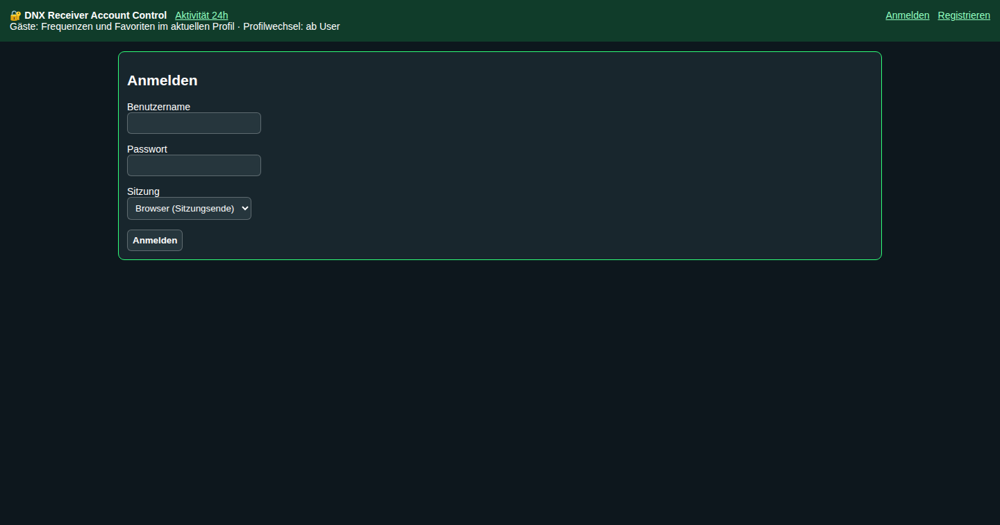
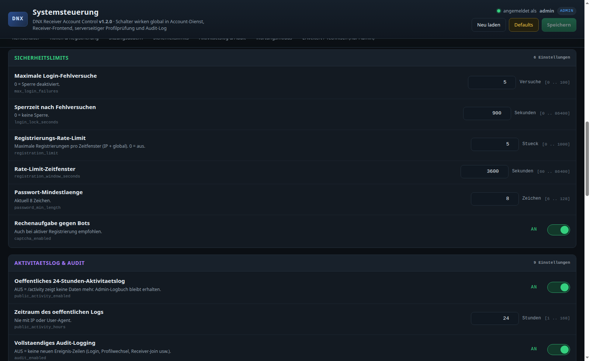
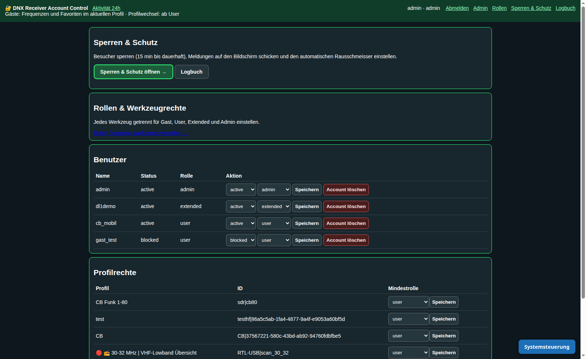
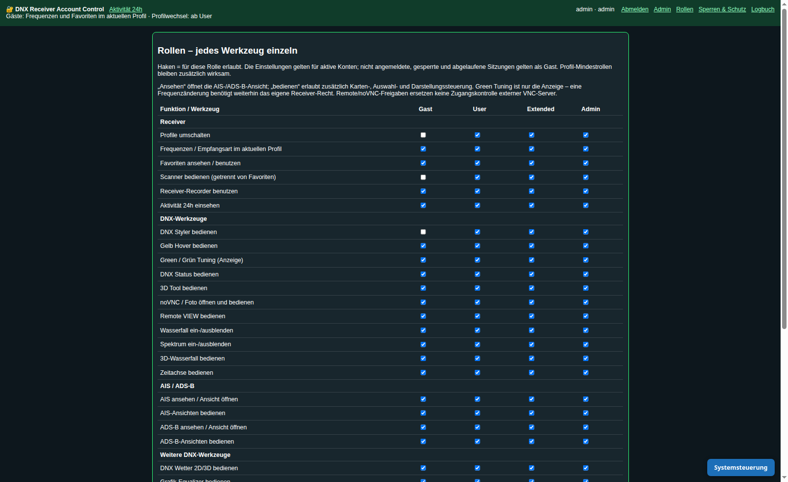
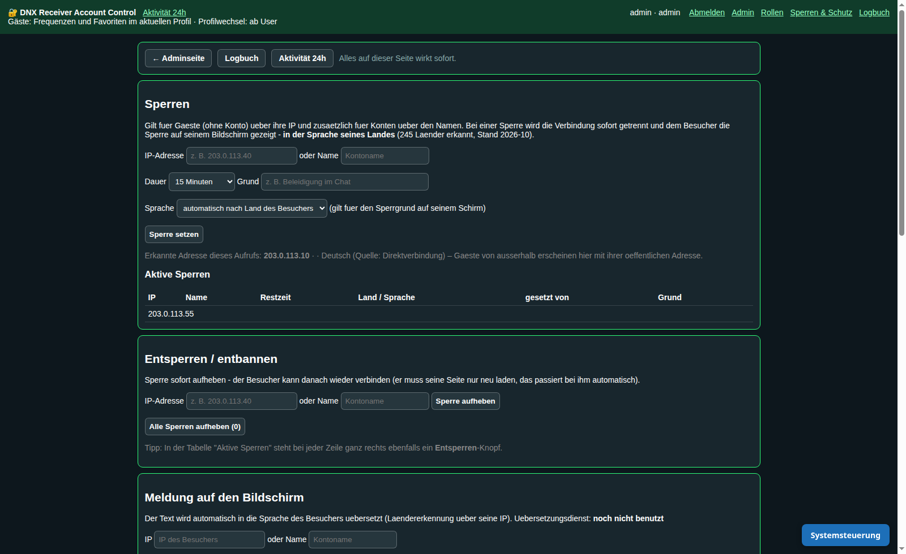
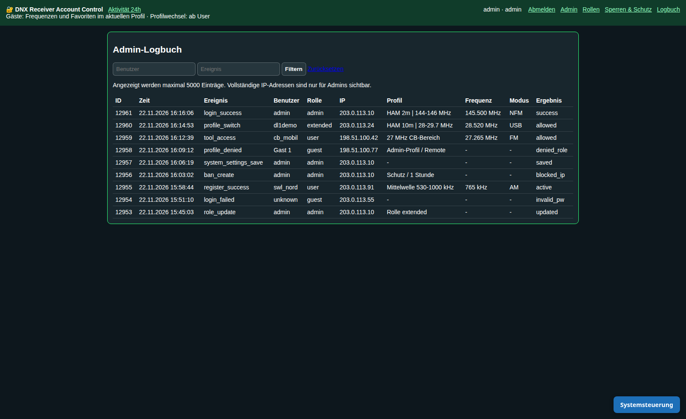
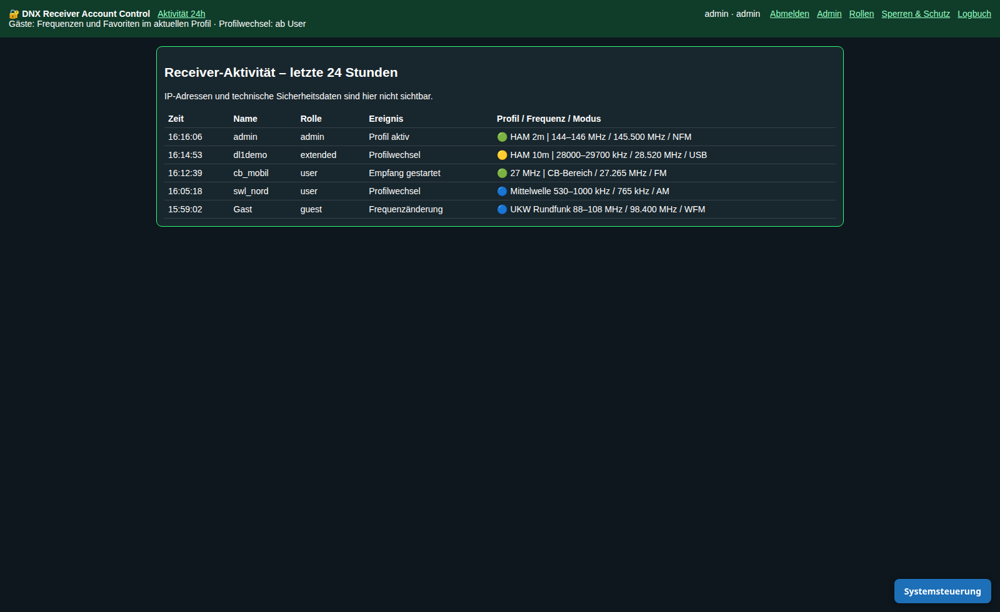
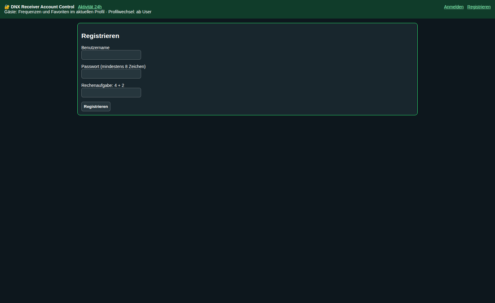

# DNX Receiver Account Control – Systemsteuerung (`v1.2.1`)

<!-- DNX-DISCLAIMER-START -->
> **Wichtiger Hinweis / Vollständige Distanzierung (Hobby-Mod-Mode)**
>
> - **Vollständige Distanzierung:** Ich distanziere mich in jeder Hinsicht vollständig vom Projekt **OpenWebRX / OpenWebRX+** sowie dessen Entwicklern und Betreibern. Es besteht keinerlei Verbindung, Zusammenarbeit, Prüfung, Befürwortung oder Partnerschaft.
> - **Keine öffentlichen/offiziellen OpenWebRX-Plugins (nur Mod-Mode):** Bei diesem Projekt handelt es sich ausdrücklich **nicht** um ein öffentliches oder offizielles Plugin von OpenWebRX, sondern ausschließlich um einen privaten, inoffiziellen **Mod-Mode** (Eigenmodifikation).
> - **Warum bewusst kein reines Browser-JavaScript (Mod-Mode-Architektur):** Viele Funktionen (z. B. serverseitige Speicherung, Konten-/Rollenverwaltung, Profil-Synchronisation, VNC-/websockify-Brücken, geschützte Schnittstellen, Docker-/Systemintegration und stabile UI-Anpassungen) lassen sich sauber und sicher nicht allein über simples Client-JavaScript umsetzen, ohne den OpenWebRX-Kern umzubauen oder Browsergrenzen zu umgehen. Deshalb setzt dieses Projekt bewusst auf getrennte Begleitmodule, Shell-Installer und Dienste im **Mod-Mode** statt alles künstlich in reines JavaScript zu pressen.
> - **Kein öffentlicher Support & keine Haftung:** Es gibt **keinen öffentlichen Support**, keine Garantie und keine Haftung. Nutzung, Installation und Anpassung erfolgen vollständig auf eigene Gefahr (immer vorher Backups anlegen und zunächst im eigenen Testsystem prüfen).
> - **Reines Hobbyprojekt – frei nutzbar, änderbar & verbreitbar:** Dieses Projekt entsteht ausschließlich aus reinem Hobby und Interesse am gemeinsamen Funk-/SDR-Hobby. Es steht ausdrücklich frei zur Verfügung und darf frei genutzt, weiterverbreitet, verändert und verbessert werden.
<!-- DNX-DISCLAIMER-END -->

> **Important Notice / Full Disassociation (Hobby Mod-Mode Only)**
>
> - **Full Disassociation:** I completely disassociate myself from **OpenWebRX / OpenWebRX+** and its developers/maintainers. There is no affiliation, endorsement, review, or partnership of any kind.
> - **No Official/Public OpenWebRX Plugins (Mod-Mode Only):** These files are **not** official or public OpenWebRX plugins, but purely unofficial hobby modifications (*mod-mode*).
> - **No Public Support & No Warranty:** There is **no public support**, no warranty, and no liability. Use entirely at your own risk.

<!-- DNX-PREVIEW-START -->
## Live-Vorschau & Galerie (`DNX Receiver Account Control`)



| Ansicht | Beschreibung | Screenshot |
|---|---|---|
| **Systemsteuerung (`Kernschalter` & `Rollen`)** | Globale Live-Statusübersicht (13 Status-Pills), `Kernschalter` (Registrierung, Profilsteuerung, Account-Zwang, Gast-Profilwechsel, Wartungsmodus) & `Rollen & Registrierung` |  |
| **Sicherheitslimits & Audit-Log** | Konfigurierbare Schwellen (`max_login_failures`, Sperrzeit, Rate-Limits, Passwort-Mindestlänge, Bot-Captcha) & Audit-/24h-Aktivitätsgrenzen |  |
| **Benutzerverwaltung & Profilrechte** | Kontenverwaltung (`active` / `blocked`, Rolle `admin` / `extended` / `user`) sowie Profil-Mindestrollen pro Empfängerprofil (`Mindestrolle`) |  |
| **Rollen & Werkzeug-Freigaben** | Feingranulare Rechte-Matrix (`Gast`, `User`, `Extended`, `Admin`) einzeln für jedes Empfänger-Werkzeug |  |
| **Schutz & Sperrverwaltung** | IP- und Konten-Sperren mit Ländererkennung (245 Länder) & automatisch übersetzter Sperrmeldung, Entsperren und Bildschirm-Hinweisen |  |
| **Admin-Logbuch** | Durchsuchbares Sicherheits- und Ereignis-Logbuch (`login_success`, `profile_switch`, `tool_access`, `ban_create`, `system_settings_save`) inkl. IP, Profil & Frequenz |  |
| **Öffentliche 24h-Aktivität** | Datenschutzbereinigte 24-Stunden-Übersicht (`/activity`) aktiver Profile, Frequenzen und Modi ohne IP- oder Geräte-Details |  |
| **Registrierung & Bot-Schutz** | Self-Service-Registrierung mit serverseitig erzwungener Passwort-Mindestlänge, Rechenaufgabe gegen Bots und Statusleiste |  |
<!-- DNX-PREVIEW-END -->

> **Stand `v1.2.1`:** Einstellungen-Speicher (`settings_store.py`), Integrations-Helfer (`dnx_system_control_integration.py`), Setup-Verdrahtung (`setup_app.py`: Provider, Systemsteuerung-Button) sowie Receiver-Frontend-Status (`dnx_system_state.js`) aktualisiert und gegen bestehende Konten-/Log-Datenbanken abgesichert.

Neuer Admin-Bereich **Systemsteuerung** unter der bestehenden Adminseite: globale
Schalter, die nicht nur die Oberfläche verändern, sondern **konsistent** wirken in

1. Account-Webdienst (Port 8096)
2. Receiver-Frontend (OpenWebRX+-Plugin)
3. serverseitiger OpenWebRX-Profilprüfung (OpenWebRX-Container (z. B. `openwebrx`))
4. Audit-/Aktivitätslog

Stand: 13. Oktober 2026 · Basis: Übergabe-PDF `DNX OpenWebRX Übergabe für Admin Systemsteuerung.pdf`

---

## 1. Was enthalten ist

```
dnx-system-control/
├── account-service/
│   ├── dnx_system_control/
│   │   ├── settings_store.py      access_settings: atomar, sichere Defaults, Audit
│   │   ├── access_rules.py        Entscheidungslogik (Rollen, Profile, Wartung, Limits)
│   │   ├── admin_api.py           Flask-Blueprint: /admin/system + APIs (Admin-only, CSRF)
│   │   └── web/                   Admin-Panel (HTML/CSS/JS, kein Polling, keine CDN-Last)
│   └── migrate_add_access_settings.py   Migration inkl. Backup + Bestandsdaten-Beweis
├── integration/
│   ├── dnx_system_control_integration.py  Einbau-Helfer: 2 Zeilen in app.py
│   └── app_integration_example.py         lauffähige Referenz-/Demo-Implementierung
├── frontend/
│   └── dnx_access_control/dnx_system_state.js   Receiver-Frontend-Baustein
├── owrx/
│   └── dnx_system_verify.py       serverseitige Profilprüfung + DSP-Schutz (Container)
├── scripts/
│   ├── install.sh                 Backup → Kopieren → Migration → Container → Checks
│   ├── rollback.sh                Zurückspielen (optional inkl. Datenbank)
│   └── smoke_tests.sh             Kapitel-15-Tests + neue Endpunkte
├── tests/                         86 Unit-/Integrationstests (unittest, ohne pytest)
├── INTEGRATION.md                 exakte Einbaupunkte für app.py, init.js, connection.py
├── TESTMATRIX.md                  Testmatrix Gast/User/Extended/Admin
└── preview/systemsteuerung-vorschau.html   Offline-Vorschau des Panels
```

## 2. Die Schalter

**Kernschalter** (exakt die gewünschte Liste)

| Schalter | Schlüssel | Default |
|---|---|---|
| Registrierung AN/AUS | `registration_enabled` | AN |
| Neue Konten sofort aktiv AN/AUS | `new_accounts_active` | AN |
| Profilsteuerung AN/AUS | `profile_control_enabled` | AN |
| Gast darf Profile wechseln AN/AUS | `guest_profile_switch` | AUS |
| User-Rolle erlaubt AN/AUS | `role_user_enabled` | AN |
| Extended-Rolle erlaubt AN/AUS | `role_extended_enabled` | AN |
| Standardrolle neuer Konten | `default_registration_role` | `user` (auch `extended`) |
| Account-Zwang AN/AUS | `account_required` | AUS |
| Wartungsmodus AN/AUS | `maintenance_mode` | AUS |

**Zusätzlich**

| Bereich | Schlüssel |
|---|---|
| Sitzungsdauern | `allowed_session_browser/_day/_week/_month/_forever` |
| Sicherheitslimits | `max_login_failures`, `login_lock_seconds`, `registration_limit`, `registration_window_seconds`, `password_min_length`, `captcha_enabled` |
| Aktivität/Audit | `public_activity_enabled`, `public_activity_hours`, `audit_enabled`, `max_audit_entries`, `max_audit_bytes` |
| Wartung | `maintenance_admin_bypass`, `maintenance_message`, `maintenance_lock_existing_sessions` |

**Admin-Zusatzeinstellungen** (Bereich „Erweitert / Technisch (nur Admin)“)

| Schlüssel | Default | Zweck |
|---|---|---|
| `audit_settings_changes` | AN | Wer welchen Schalter wann umgelegt hat – unabhängig von `audit_enabled` |
| `audit_auto_purge` | AUS | automatische Löschung (derzeit deaktiviert, wie in der Übergabe) |
| `audit_retention_days` | 0 | 0 = unbegrenzt, nur mit `audit_auto_purge` |
| `audit_timezone` | `Europe/Berlin` | Anzeige, DB bleibt bei Unix-Zeitstempeln |
| `downgrade_disabled_roles` | AN | abgeschaltete Rolle wird **wirksam** herabgestuft, DB-Rolle bleibt |
| `revoke_sessions_on_change` | AUS | Bestandsuser bleiben angemeldet |
| `settings_cache_seconds` | 3 | Cache der Container-Profilprüfung |
| `settings_fail_open` | AN | bei unlesbarer DB gelten Defaults → niemand wird ausgesperrt |
| `expose_state_to_receiver` | AN | Statuslieferung ans Frontend |
| `strict_unknown_keys` | AN | unbekannte Schlüssel beim Speichern → HTTP 400 |
| `schema_version`, `package_version` | – | schreibgeschützt, nur Anzeige |

Insgesamt **40 Schlüssel**, davon 22 exakt die in Kapitel 12 geforderten.

## 3. Bestandsuser bleiben erhalten

Das war eine Kernanforderung – und ist technisch abgesichert:

* Die Migration legt **nur** `access_settings` an. `users`, `sessions`, `audit_log`,
  `audit_settings` werden nicht angefasst.
* Vor/nach der Migration werden Zeilenanzahlen, Rollenverteilung und
  `PRAGMA integrity_check` verglichen. Bei **jeder** Abweichung bricht das Skript mit
  Fehler ab und zeigt das Backup.
* Vor dem ersten Schreibzugriff entsteht ein konsistentes, datiertes Backup
  (sqlite3-Backup-API, kein Dateikopie-Versuch bei laufendem Dienst).
* Abgeschaltete Rollen löschen oder ändern keine Konten: `extended` → wirksam `user`
  → wirksam `guest`, aber `SELECT role FROM users` bleibt unverändert
  (Test `test_abgeschaltete_rolle_wirkt_sofort_ohne_db_aenderung`).
* Defaults entsprechen dem **heutigen** Verhalten (Registrierung an, Konten sofort
  aktiv, alle fünf Sitzungsdauern erlaubt, `audit_auto_purge` aus). Die Umstellung
  ändert also erst einmal gar nichts am laufenden Betrieb.

## 4. Sicherheit

* **Admin-only**: ohne gültige `admin`-Rolle gibt es 403 – auch dann, wenn gar kein
  `current_user`-Provider registriert ist (deny by default).
* **CSRF**: Sitzungs-Token + Origin/Referer-Abgleich, `hmac.compare_digest`.
* **Rolle kommt aus der Datenbank**, nicht aus der Sitzung → Rechteausweitung über
  ein selbst gesetztes `session["role"]` funktioniert nicht (Test vorhanden).
* **Atomar**: `BEGIN IMMEDIATE` … `COMMIT`, bei einem einzigen ungültigen Wert wird
  **nichts** gespeichert (Rollback).
* **Keine Interna im öffentlichen Status**: `/api/system/state` liefert nur die
  public-Schlüssel – keine Audit-Grenzen, keine Passwortregeln, keine IPs.
* **Fail-open** an drei Stellen: `profile_control_enabled=false` sperrt niemanden,
  eine unlesbare DB liefert Defaults, ein Fehler in `install()` legt den
  Account-Dienst nicht lahm.
* Kleine Schreib-Rate-Limit (30/60 s) gegen Durchklick-Unfälle.

## 5. Live ansehen (Demo)

Die Referenz-Implementierung läuft als eigener Dienst und demonstriert alle
Integrationspunkte inklusive Receiver-Frontend:

```bash
pip install flask                      # einzige Abhängigkeit der Demo
python3 integration/app_integration_example.py
```

| URL | Inhalt |
|---|---|
| `/admin/system` | **die neue Systemsteuerung** (Login: `dl1abc` / `admin123`) |
| `/receiver-simulator` | Frontend-Reaktion auf die Schalter (Banner, Register-Button, Sitzungsdauern, Profilwahl) |
| `/profiles` | Profilentscheidungsmatrix für die aktuelle Rolle |
| `/admin/users` | Bestandskonten mit DB-Rolle und *wirksamer* Rolle |
| `/admin/logbook` | volles Audit-Log inkl. `admin_access_settings` |
| `/activity` | öffentliches 24-h-Log (ohne IP/User-Agent) |
| `/api/system/state` | öffentlicher Status für das Receiver-Frontend |

Demo-Konten: `dl1abc/admin123` (admin), `dl2xyz/user1234` (extended),
`do3test/user1234` (user). Die Demo-Daten liegen in `demo-data/` und haben mit dem
Produktivsystem nichts zu tun.

## 6. Tests

```bash
cd dnx-system-control
python3 -m unittest discover -s tests -t . -v
```

**86 Tests**, alle grün (Python 3.13, SQLite 3.46). Abgedeckt: Migration +
Bestandsdatenbeweis, Atomarität, Validierung, Defaults, Audit in fremde
Tabellenschemata, Purge, öffentliche/nicht-öffentliche Schlüssel, Fail-open,
CSRF, Admin-only, Rate-Limit, Rollen-Herabstufung, Wartungsmodus mit/ohne Bypass,
Profilentscheidungsmatrix (16 Fälle), `profile-policy.json`-Varianten,
Container-Hook inkl. DSP-Property-Filter.

## 7. Installation auf `<SERVER-IP>`

```bash
# 0) Übergabe-PDF und aktuelle Backups prüfen (Kapitel 11)
# 1) Paket auf den Server kopieren, z. B. nach $HOME/dnx-system-control
cd $HOME/dnx-system-control

# 2) trocken durchlaufen lassen – zeigt jeden Schritt
sudo ./scripts/install.sh --dry-run

# 3) Ist-Zustand prüfen
sudo ./scripts/install.sh --check

# 4) installieren (legt zuerst datierte Backups an)
sudo ./scripts/install.sh

# 5) zwei Zeilen in app.py ergänzen (das Skript ändert app.py NIEMALS selbst)
#    import dnx_system_control_integration as dnx_sc
#    dnx_sc.install(app)
sudo systemctl restart dnx-access-control.service

# 6) prüfen
sudo ./scripts/smoke_tests.sh
```

Danach: `http://<SERVER-IP>:8096/admin/system`

**Rollback**: `sudo ./scripts/rollback.sh --list` → `sudo ./scripts/rollback.sh`
(Datenbank nur mit `--with-db`, sonst bleiben Konten/Logs unangetastet).

Alle Details, auch für `init.js`, `connection.py` und `dnx_access_verify.py`:
→ **INTEGRATION.md** · Abnahmetests → **TESTMATRIX.md**

## 8. Bewusst nicht gemacht

* **`app.py` wird nicht automatisch gepatcht.** Zu riskant ohne Kenntnis der
  bestehenden Struktur. Stattdessen: 2-Zeilen-Einbau + fertige Helferfunktionen
  (`registration_gate`, `login_gate`, `session_choices`, `profile_check`,
  `audit_event`) und eine lauffähige Referenz zum Abkupfern.
* **Kein eigenes Polling** im Frontend: einmal laden beim Öffnen, dann nur auf
  Knopfdruck oder auf Zuruf (`dnx:system-state`, `refresh()`). Kapitel 14.
* **Audit-Umbau `receiver_join`/`receiver_leave`** (Profil, Frequenz, Modus,
  Deduplizierung) ist nicht Teil dieses Pakets – das ist laut Übergabe ein
  gemeinsamer Patch an `connection.py`/`client.py` und gehört in ein eigenes
  Paket. Die Systemsteuerung liefert dafür aber schon `audit_enabled`,
  `audit_auto_purge`, `max_audit_entries`, `max_audit_bytes` und `audit_event()`.
* **Kein öffentlicher Download/ZIP**: `scripts/` enthält Pfade, aber keine Secrets.
  Backups enthalten Schlüssel und bleiben privat (Kapitel 11/14).

## 9. Was ich nicht verifizieren konnte

Die Sandbox hat keinen Zugriff auf `<SERVER-IP>`. Deshalb sind diese Stellen
**tolerant** gebaut, müssen aber beim Einbau einmal gegen die echten Dateien
gegengeprüft werden (steht so auch in INTEGRATION.md):

| Annahme | Absicherung |
|---|---|
| Spaltennamen von `audit_log` | Audit-Writer erkennt `ts/timestamp/created_at`, `event/type/action`, `username/account/…`, `ip/remote_addr`, `user_agent/agent`, `details/data/extra` automatisch |
| Aufbau von `profile-policy.json` | Loader versteht `{"protected":[…]}`, `{"profiles":{…roles…}}`, `{"roles":{…}}` und reine Listen; Fehler → keine Sperren |
| Sitzungsschlüssel in `app.py` | `detect_user()` probiert 7 Benutzer- und 5 Rollenschlüssel, plus DB-Abgleich; eigene Schlüssel sind konfigurierbar |
| DB-Pfad im Container | `DNX_ACCOUNTS_DB` > `/var/lib/openwebrx/dnx-access-control/accounts.sqlite3` > Host-Pfad |


## Rechtlicher Hinweis / Disclaimer

**DE:** Private, inoffizielle Hobby-Anpassung (Mod-Mode) für OpenWebRX / OpenWebRX+. Kein offizielles OpenWebRX- oder OpenWebRX+-Projekt, keine Verbindung zu oder Unterstützung durch die jeweiligen Entwickler. Nutzung erfolgt vollständig auf eigene Gefahr; soweit gesetzlich zulässig wird jede Haftung ausgeschlossen. Vor dem Einspielen bitte Sicherungen anlegen.

**EN:** Private, unofficial hobby modification (Mod-Mode) for OpenWebRX / OpenWebRX+. Not an official OpenWebRX or OpenWebRX+ project; no affiliation with or support from its maintainers. Use entirely at your own risk; to the extent permitted by law, no liability is accepted. Always create backups before installing.

---

## Verbindungen im DNX-Ökosystem, Rechte-Matrix & Benutzer-Persistenz


### Wie die Konten- & Rechte-Schnittstelle alle Module steuert

* **Live-Rechte-Endpunkt (`GET :8095/api/me` + `GET :8096/api/system/state`):** Liefert die effektive Rolle (`guest`, `user`, `extended`, `admin`) sowie **`32` einzelne Werkzeugrechte** an das Receiver-Frontend (`window.DNXReceiverRights.can(...)`), u. a.:
  * `styler` (schaltet `#dnx-styler-launch`, `#dnx-styler-ui` sowie die Admin-Übernahme-Knöpfe `Standard für alle`, `S-Meter für alle übernehmen` und `Für alle übernehmen` in `DNX-Styler` frei),
  * `waterfall3d`, `tool3d`, `spectrum_display`, `waterfall_display`, `yellow_hover`, `green_tuning`, `equalizer`, `fx`, `timeline`, `dnx_status`, `novnc`, `remote`,
  * `profile_switch`, `scanner`, `favorites`, `administration`, `activity24h`, `downloads`, `adsb_*`, `ais_*`, `project_*`.
* **Ausfallpuffer im Browser (`dnx_rechte_puffer.js`):** Bleibt der Konto-Dienst länger als `6 Sekunden` aus, hält das Frontend-Puffer-Skript die zuletzt bekannten Rechte bis zu **`12 Stunden`** stabil, sodass Oberflächen-Werkzeuge bei Wartungen nicht wegflackern.
* **Serverseitige Profil-Verifizierung (`owrx/dnx_system_verify.py`):** OpenWebRX+ prüft Profilwechsel direkt gegen `accounts.sqlite3` (`access_settings`) und `profile-policy.json`, sodass API- oder UI-Manipulationen ausgeschlossen sind.
* **Abgrenzung der Speicherebenen:**
  1. **Konten, Rollen, Sperren & Profilrechte** liegen in `accounts.sqlite3` (`:8095/:8096`).
  2. **Persönliche Optiken & Pegel je Band** liegen im Browser (`localStorage`) bzw. pro SDR-Profil (`waterfall_pro.js` + `styler_share.py :8098`).
  3. **Globale Design-Standards (`Standard für alle`)** verteilt `styler_share.py` (`:8098`) per SSE-Push (`/dnx/styler/events`), sichtbar/auslösbar nur mit dem Recht `styler`.
  4. **Benutzerbezogene Remote-Workspaces** speichert `DNX-Remote-VIEW` (`:8099`) unter `/save_user/<user>`.
